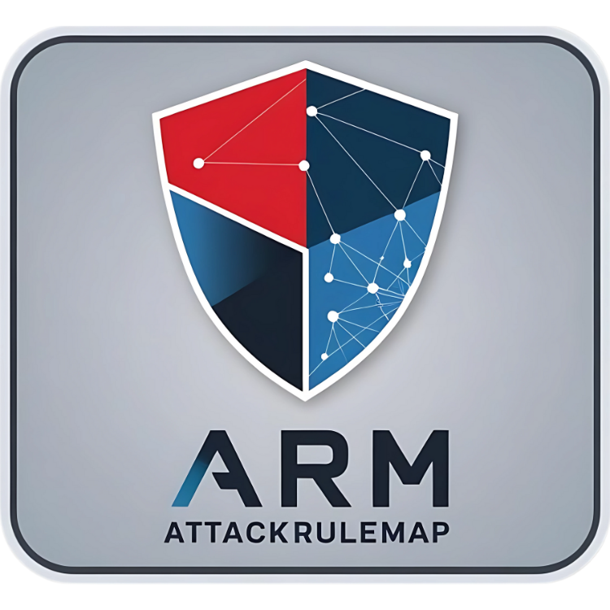

#  AttackRuleMap

This repository provides a mapping of Atomic Red Team attack simulations to open-source detection rules, such as Sigma and Splunk ESCU.

### [Go to AttackRuleMap](https://attackrulemap.com)

## 🎯 Project Purpose
The goal of this project is to bridge the gap between Atomic Red Team's adversary simulations and open-source detection rules. By doing so, this project aims to help security professionals simulate attacks and evaluate their detection strategies more effectively. 🔒

## 🧬 Project Origin (Proof-of-Concept to Scalable Validation)

AttackRuleMap started as a hands-on lab simulation effort. In the initial phase, I:

- Executed Atomic Red Team tests  
- Ran Sigma and Splunk ESCU detections  
- Recorded which rules fired for which techniques  

### Environment Setup (Initial Phase)
- Operating System: Windows Server 2019 (virtualized)  
- Testing Tool: Atomic Red Team (PowerShell + manual adjustments where needed)  
- Log Ingestion/Analysis: Splunk Enterprise  
- Performance: Datamodel acceleration enabled to support multi-threaded searching  
- Detection Rules: Sigma + Splunk ESCU  

This approach produced the first mapping dataset and validated that detections could be tested against real adversary simulations.

> However, this process was partially manual and not scalable across the full MITRE ATT&CK matrix.

---

### 🚀 Scaling the Approach with Automation

To overcome these limitations, the project evolved with a community contribution, introducing an automated validation pipeline.

This extension transformed AttackRuleMap from a static mapping into a **continuous validation system** that:

- Automatically executes Atomic Red Team tests  
- Queries detection rules within a controlled time window  
- Correlates results to avoid false positives  
- Generates updated mapping data and ATT&CK coverage layers  
- Feeds a dynamic dashboard for visualization  

With this approach, AttackRuleMap moves from **manual validation** to **evidence-based, repeatable detection testing at scale**.

> This evolution enables security teams to continuously validate detection coverage instead of relying on assumed effectiveness.

[Check post for automation details](https://emre-guler.medium.com/attackrulemap-scaling-the-bridge-between-detections-and-tests-via-automation-507f9c5c2b5a) by [@emregulerr](https://github.com/emregulerr)

## 🔄 Sigma Rule Conversion
To convert Sigma rules into Splunk Search Processing Language (SPL), I used the [sigconverter.io](https://sigconverter.io) locally on Docker. This tool simplifies the process of adapting Sigma rules for use in Splunk by automating the translation process. Users can specify the desired target platform, such as Splunk, Elastic, Kusto or any platform that supported by sigconverter, and the tool generates platform-specific queries based on Sigma's rule definitions.

## 🤝 Contribution
This project is open to contributions from the community. Here are some ways you can contribute:

- **Platform Testing:** Test and validate the detection rules on non-Windows platforms, such as Linux or macOS.
- **Feedback and Suggestions:** Share your ideas for improving the project or addressing potential gaps.

If you'd like to contribute, feel free to submit a pull request or open an issue. 💡

## Contributors

- [@Niicolaa](https://github.com/Niicolaa)
- [@emregulerr](https://github.com/emregulerr)
